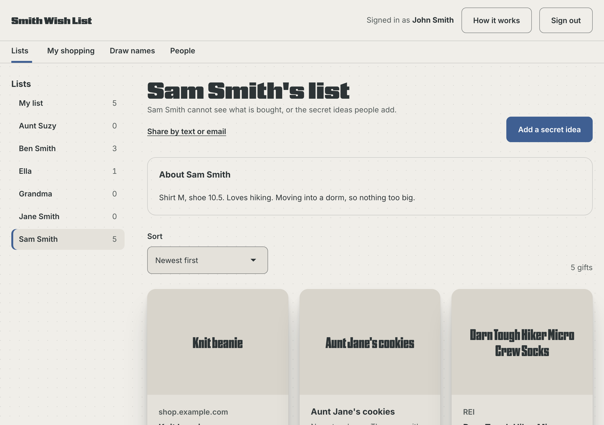
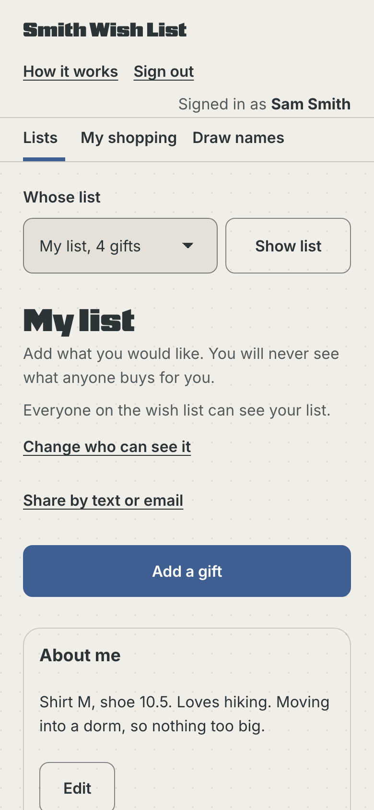
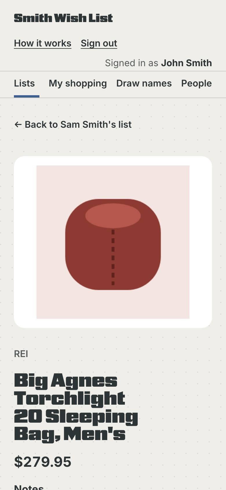
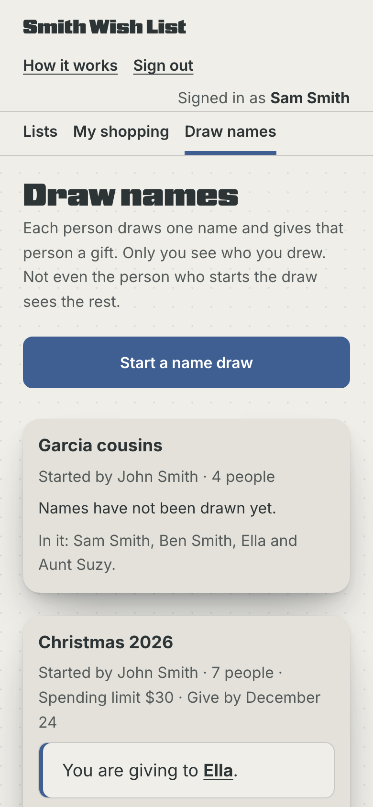
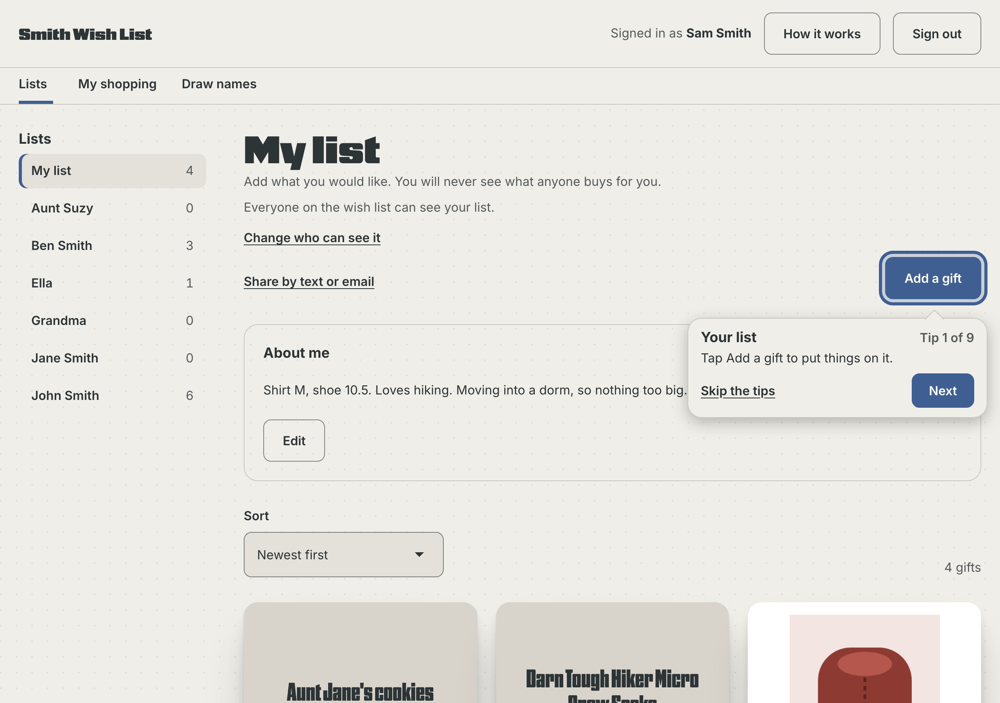
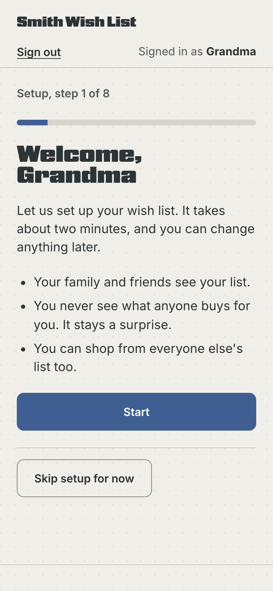
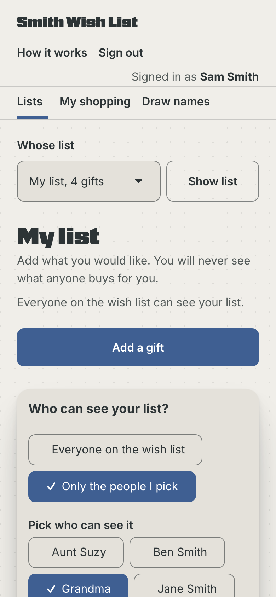

# Family Wish List

One wish list for the whole family, from any store, where the person a gift is for never sees what was bought.



Designed and built by **Steven Vanden Heuvel** ([Steven Design Co.](https://stevendesignco.com)). I built it for my own family's Christmas and birthday lists. This public copy uses made-up people (the Smiths, the Garcias) and is shared as a portfolio piece and for anyone who wants to run their own.

## Why I built it

Store wish lists tie a family to one store, and most list apps assume everyone is at ease with apps, accounts and passwords. My family includes grandparents who are not, and kids who are just learning to read a screen. So the brief was short:

- Any store, or something homemade.
- No passwords.
- Big, plain buttons that say what they do.
- A surprise that cannot be spoiled, even by someone who knows how to read a web page's data.

## What it does

- **One list per person,** from any store. Paste a link, tap the Add to Wish List button on a store's page (a bookmark on a computer, a Shortcut on iPhone, the Share menu on Android), or write something in, like "Grandma's cookies".
- **Shoppers mark what they bought,** go in together on a big gift, and add secret ideas to someone's list.
- **The person a list is for never sees** purchases, chip-ins or secret ideas.
- **Kids' lists,** kept by their parents. A child needs no email; a parent adds the list and decides whether the parents see purchases.
- **Who can see a list:** everyone in the family, or only the people the owner picks.
- **Who can see one gift:** any gift can be shown to only the people you pick, like a surprise the rest of the family is in on. That includes the admin: a surprise for the admin stays a surprise unless you pick them. The people picked see it marked "Shown only to some people", so nobody mentions it to the wrong person.
- **How many and notes on every gift,** right on the form: "3 pairs, size L, any color but pink." Cards show the start of the note.
- **Draw names** (Secret Santa). Only the giver sees who they drew, not even the person who started the draw. Spending limit, give-by date, and pairs to keep apart; parents and their own kids never draw each other.
- **Ask to join.** A relative who is not on the list can ask from the sign-in page. Only the admin adds people.
- **Share by text or email.** Every list has a button that starts a text or an email with the list's link written in, so someone using the installed app (which has no address bar) can pass a list along. There is no copy-the-link button on purpose.
- **A safety check on every store link.** See below.
- **My shopping:** everything you bought, in one place. Tap "It has been given" after a gift is opened. Anything still marked bought counts as given on December 26.
- **Sizes and favorites** on each list, so clothes fit and nobody gets peanuts by mistake.
- **First-run setup,** one question per screen, then a short tour that points at the real buttons.

<p>
  
  
  
</p>

## The promise, kept on the server

Hiding purchases in the page is not enough: anyone can open a browser's developer tools and read the data a page receives. So the rule lives on the server, in [`site/lib/lists/rules.js`](site/lib/lists/rules.js) (`view()`). When you open your own list, your browser is never sent who bought what, who chipped in, or the secret ideas others added. The same function leaves out lists and gifts that are not shared with you, and the full list of name draw matches is never sent to anyone.

Every change goes through the same file (`apply()`), which checks who is asking before it saves anything. The API tests check the rule from every side, including twelve random name draws per run checked against every pairing rule, and 300 made-up groups where the draw rules are compared with every possible way to match the names.

### Who always sees a list, or a gift

Limiting who sees something never hides it from the people who need it:

- **A list** is always seen by its owner, a kid's parents, the admin, and anyone who drew that person in a name draw.
- **A gift shown to only some people** is always seen by whoever added it, the list's owner and a kid's parents (for their own gifts, never a secret idea), and anyone who already bought it or chipped in. The admin is not an exception, so a surprise for the admin stays a surprise. The one exception is a gift whose author was removed from the list, so it is never stuck where nobody can change it.
- **A name draw** stays a secret from whoever set it up. A draw is refused when its Keep apart pairs would leave someone only one person to draw, or (above three people) only two ways to match everyone, since then the matches could be worked out. Everyone in a draw sees how many pairs are kept apart. Drawing a name never opens a list to someone it was hidden from: for a kid, every parent who keeps the kid's list must already see the person drawn.

## Designed for grandparents and kids

- **One job per screen:** a list, one gift, My shopping, Draw names, or People.
- **The Back button works.** Every screen has its own address, and forms and confirm steps have their own history entry, so Back closes them instead of leaving the page.
- **Plain words on big buttons:** "Buy it at REI", "I bought this", "It has been given". Text links for quieter actions, like "Skip the tips".
- **Cards carry no buttons.** Each card is one link to the gift's page, where the buttons are.
- **No passwords.** Sign-in is a six-digit code (or link) by email, and you stay signed in on that device for a year. The code exists because a phone's email app often opens links in its own browser. Each link works once, and only the newest one works. Opening the link does not sign you in by itself: the page does, so an email service that opens links ahead of time to scan them cannot use one up.
- **16px for everything you read, 44px tap targets,** and messages that stay on screen until the next action. (The one exception is the iPhone shortcut's script, which is code to copy, not to read.)
- **Tour tips that point at the real thing.** On a computer each tip sits beside the button it describes, with an arrow; on a phone it docks at the bottom or top, wherever it does not cover the button.



## Accessibility and testing

Everything is driven the way a person would use it, in a real browser:

- **api:** over 780 checks of the rules, sign-in, photos, link lookups and link safety, robots.txt, list and gift sharing, join requests and name draws.
- **flow, onboard, family:** click-through suites in Chromium on a computer and a phone, from first sign-in to drawing names.
- **screens:** 55 screens in light and dark, at phone and computer widths, each run through [axe](https://github.com/dequelabs/axe-core) for WCAG 2.2 AA, with checks for sideways scrolling and page errors.
- **grid:** fields that sit side by side line up.
- **check:styles:** proves the trimmed design system styles match the full ones, element by element.

Automated runs are not the whole story. A real iPhone showed the tour tip filling the screen when every automated WebKit run said it was a quarter of the height. iOS 26 Safari sizes a modal dialog to its full maximum height. It is fixed (`height: auto`), and phone screens are now also checked in the iOS Simulator.

## Built with

- **Plain HTML, CSS and JavaScript.** No framework and no build step.
- **Vercel Functions,** all routes served by one function ([`site/api/lists/[route].js`](site/api/lists/[route].js)), and **Vercel Blob** storage: one JSON file, saved with an ETag check so two people saving at once never overwrite each other.
- **Resend** for the sign-in emails.
- **SDC,** the Steven Design Co. design system: its tokens and its Button, Field, Select, Choice and Fieldset components. This repo carries **SDC lite**, the parts of SDC the app uses, generated by [`scripts/trim-sdc.mjs`](scripts/trim-sdc.mjs).
- **Playwright** and **axe-core** for the tests.

## Store links, and the line this app does not cross

Big stores (Amazon, Target, LEGO, REI, Etsy, Best Buy) do not let apps read their pages. This app names itself honestly, honors each store's robots.txt, and never pretends to be a browser to get around a block. Instead:

- **The store button** reads the product page you are already looking at, in your own browser, and brings its name, photo and price to your list.
- **A pasted link** still gets a name when the store says no: most store links carry the product name in the address itself, so the app reads it from the link without contacting the store.

<p>
  
  
</p>

## A safety check on every store link

The person most at risk from a bad link is not the one who adds it, it is the grandparent who taps "Buy it" later. So every store link is checked on the server when it is added or changed, and the result travels with the gift: a warning under Store link in the form, on the gift's page above the store button, and a tag on its card. It warns and never blocks.

- **On the link itself, instantly:** http instead of https, a bare number address, letters from another alphabet that imitate ours, a big store's name on someone else's site (amazon-deals.shop), a name one letter off a big store's (amazom.com), a store's name used as the start of another site's address (amazon.com.account-verify.io), short links that hide where they go, and web address endings that scam stores favor.
- **Looked up, in a few seconds at most:** whether any website answers at that name, whether its security certificate checks out, and how long ago the name was registered (from the public RDAP records). A short link is followed to see where it really goes.
- **Optional:** set `LISTS_SAFE_BROWSING_KEY` to a [Google Safe Browsing](https://developers.google.com/safe-browsing/v4/get-started) API key (free for non-commercial use) and the check also asks whether Google lists the site as a scam or harmful site. That sends the link to Google.

The checks live in [`site/lib/lists/linkcheck.js`](site/lib/lists/linkcheck.js).

## Run it on your computer

You need [Node.js](https://nodejs.org) 20 or newer.

```
git clone https://github.com/vandy1690/family-wish-list.git
cd family-wish-list
npm install
npx playwright install chromium     # once, for the tests
npm run dev                         # http://localhost:4380/lists
```

Sign in as `john@example.com`: while nobody is on the list, only that address can sign in, and it becomes the admin (set `LISTS_ADMIN_EMAIL` and `LISTS_ADMIN_NAME` to use another). No email is sent on your computer: the code, and a link to sign in with, appear in the sign-in box. Add the rest of the family on People, then sign in as them the same way. Data is kept in `.data/`. Another port: `PORT=4390 npm run dev`.

The local server is the only place the test switches work (plain files instead of Blob, codes shown on the page, cookies over plain http, link checks without the network). It turns them on itself, and an environment variable alone cannot, so a server set up any other way always runs the real thing.

```
npm test               # api, flow, onboard, family, grid
npm run test:screens   # every screen, with axe, into .test-output/screens/
npm run docs:screens   # also refreshes the screenshots in docs/screens/
```

## Deploy your own

You need a [Vercel](https://vercel.com) account (the free plan is enough) and a [Resend](https://resend.com) account with a domain you can add DNS records to.

1. **Fork this repo.** In Vercel, make a new project from your fork and set its Root Directory to `site`.
2. **Storage:** in the project's Storage tab, create a Blob store (private) and connect it. That adds the store's setting for you (`BLOB_READ_WRITE_TOKEN`, or `BLOB_STORE_ID` on newer stores).
3. **Email:** in Resend, add your domain, add the DNS records it shows, and make an API key once it says Verified.
4. **Settings:** add these environment variables in the Vercel project.

   | Variable | What it is |
   |---|---|
   | `LISTS_SECRET` | A long random string that signs sign-in links. Make one with `openssl rand -hex 32`. |
   | `LISTS_ORIGIN` | Where the app lives, like `https://wishlist.example.com`. |
   | `LISTS_ADMIN_EMAIL` | Your email. The first sign-in must use it, and becomes the admin. |
   | `RESEND_API_KEY` | The key from Resend. |

   Optional:

   | Variable | What it is |
   |---|---|
   | `LISTS_ADMIN_NAME` | Your name for the first sign-in. You can change it on People later. |
   | `LISTS_FROM` | The sender. Default: `<short name> <lists@your-domain>`, from `LISTS_ORIGIN`. |
   | `LISTS_REPLY_TO` | Where replies go. Default: `LISTS_ADMIN_EMAIL`. |
   | `LISTS_TITLE`, `LISTS_SHORT_TITLE` | Starting names for the list. The People page overrides them. |
   | `LISTS_CONTACT_EMAIL` | The footer's "Email" link. Default: `LISTS_ADMIN_EMAIL`. |
   | `LISTS_ADOBE_FONTS_KIT` | An Adobe Fonts project id, for the SDC display face (see Fonts). |
   | `LISTS_SAFE_BROWSING_KEY` | A Google Safe Browsing key, for the link check (see above). |

5. **Deploy,** then open `/api/lists/health`. `app` should say `ok` and every other value should be `true`. It only says each setting exists; the first sign-in proves storage and email work.
6. **Sign in** with `LISTS_ADMIN_EMAIL`, go through setup, then on **People** give the list its name and add your family.

## Fonts

Body text is **Inter**, included (SIL Open Font License, in `site/lists/fonts/`). Headings are designed for **Nickel Gothic Variable**, an Adobe font that cannot be shared in a repo. Without it, headings fall back to a heavy Inter and everything still works.

If you have Adobe Fonts (any Creative Cloud plan), you can have the intended look: in Adobe Fonts, make a Web Project with Nickel Gothic Variable, add your domain to it, and set `LISTS_ADOBE_FONTS_KIT` to the project id.

## How the code is laid out

```
site/                      what gets deployed (the Vercel Root Directory)
  lists/                   the page: index.html, app.js, lists.css, sdc-lite.css, fonts/,
                           icons and the web app manifest
  lists-sw.js              lets Android install the page, so it shows up in the Share menu
  vercel.json              redirects and security headers
  api/lists/[route].js     one function for every /api/lists/... address
  lib/lists/
    rules.js               who sees what, and every change anyone can make
    store.js               Vercel Blob storage, with ETag-checked saves
    auth.js                sign-in links, codes and sessions
    meta.js                reading store links: robots.txt, address safety, names from links
    linkcheck.js           is a store link safe to open: the warnings shoppers see
    mail.js, site.js       email, and the names of this wish list
    http.js, dev.js        request helpers, and the switch for the local test server
    routes/                data, login, verify, logout, lookup, photo, request, config, health
dev/server.mjs             the local server
tests/                     the suites above, and run.mjs, which gives each one a fresh server
scripts/                   trim-sdc.mjs and check-styles.mjs (SDC lite), sync.mjs (copies
                           site/ into the author's family site)
docs/screens/              the screenshots in this README
```

## Known limits

- **No limit per network address.** Sign-in emails are capped per address (one every 45 seconds, ten a day) and join requests per day, but there is no limit per IP address. Someone who knows a family member's email could use up that person's ten emails for the day. Phones and computers already signed in are not affected, since they stay signed in for a year.
- **One JSON file.** Everything sits in one file, which suits a family of up to 80 people. It is not built for thousands.

## License

MIT, for the code and SDC lite. See [LICENSE](LICENSE). Inter is under the SIL Open Font License 1.1. Nickel Gothic is not included; it is licensed through Adobe Fonts.
